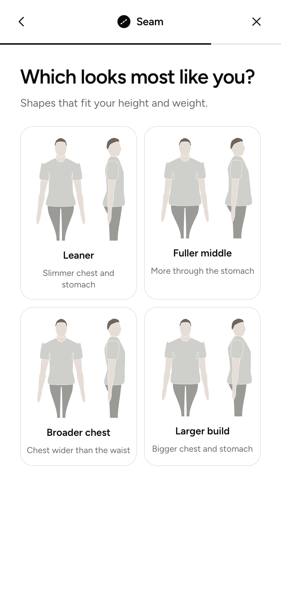
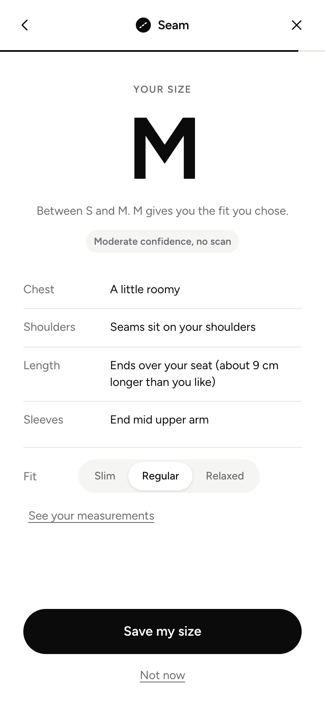
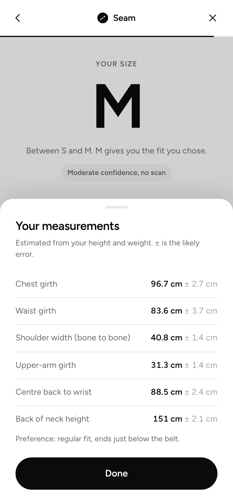

# Seam

**Find-your-size for online clothing stores.** A shopper who doesn't know their size clicks **Find Your Size** on a product page. Seam asks for their height and weight, runs a short camera scan in the browser and returns the size that fits, with plain-language notes on how it will fit at the chest, shoulders, length and sleeves.

<p align="center">
  
  
  
</p>

> **Status (October 2026):** working MVP for men's tees and long sleeves. 31 unit tests and a headless end-to-end walkthrough (desktop and phone) pass. Next: calibrate the camera against tape-measured testers, then build the Shopify app.

## How it works

| Step | What the shopper sees | What happens underneath |
|---|---|---|
| 1 | Height, weight, fit style | A statistical body model predicts 23 body measurements, each with an error band |
| 2 | Front and side camera scan (about 6 seconds) | MediaPipe finds the body outline in the browser; widths and depths are scaled by the typed height |
| 3 | "Which looks most like you?" | Four body shapes drawn at the shopper's own height and weight refine where weight sits |
| 4 | Size + fit notes | A size engine compares the body with each size of the garment and explains the fit per zone |

Video never leaves the device. A scan can only refine the height-and-weight answer: if it is poor, Seam falls back to that answer, so a bad scan can't make the result worse.

## The model

| Stage | Method | Code |
|---|---|---|
| Prior | 23 body measurements as a multivariate Gaussian conditioned on height and weight, fitted on 4,000+ men in the ANSUR II anthropometric survey | `web/src/core/bodymodel.ts`, `model/build_body_model.py` |
| Scan | MediaPipe Pose Landmarker + segmentation mask; every frame is scored out of 100 on pose checks, and a pose auto-captures at 80 | `web/src/core/measure.js`, `web/src/core/capture.ts` |
| Camera update | Kalman update: each reading = body variable + clothing offset + noise, with a shared scale error from the typed height. One reading updates all 23 variables | `web/src/core/bodymodel.ts` |
| Body-type pick | Four torso options along the two main directions of remaining uncertainty, treated as a weak extra reading | `web/src/core/picks.ts` |
| Size engine | Targets from the brand's own body chart; Monte Carlo over 4,000 sampled bodies; chest and shoulders decide, length and sleeves break ties | `web/src/core/sizing.ts` |
| Calibration | Fits camera offsets and the garment drape allowance from tape-measured sessions | `model/calibrate.py` |

## What the research showed

Regressions on the public ANSUR II data (`model/build_prior.py`), run before writing the scan:

| Finding | Result | Design consequence |
|---|---|---|
| Height and weight alone are already decent | Chest girth to about 3.1 cm; 3.8 cm when people type their own (slightly wrong) height and weight. One tee size is about 10 cm of chest | The camera has to clearly beat 3.8 cm to be worth it |
| The side view carries the accuracy | Chest width + depth: 2.1 cm. Width alone: 2.8 cm | Two poses: front A-pose and side |
| Lengths are easy, girths are hard | Upper arm 1.1 cm, shoulders 1.6 cm, torso length 2.2 cm from height and weight alone; waist 5.1 cm | The scan focuses on chest and waist |

**Accuracy bar before launch:** at least 85% of shoppers get their preferred size, nobody is off by two sizes and the full system beats height and weight alone by at least 15 points, measured with leave-one-out testing on 30 men.

## Tech stack

| Area | Tools |
|---|---|
| Web app | Svelte 5, TypeScript, Vite |
| Computer vision | MediaPipe Tasks Vision (Pose Landmarker, segmentation), in the browser |
| Modelling | Python, NumPy, pandas, scikit-learn |
| Testing | Vitest (31 tests, including the body model against a NumPy reference), Puppeteer walkthrough with a fake camera, svelte-check |

## Run it

```sh
cd web
npm install
npm run dev      # http://127.0.0.1:5173 (add ?debug=1 to see the numbers)
npm test         # unit tests
npm run smoke    # headless walkthrough of every screen (needs the dev server)
```

More detail in [`web/README.md`](web/README.md).

## Repository layout

| Path | Contents |
|---|---|
| `web/` | Find Your Size popup MVP on a demo product page |
| `scan/` | Seam Scan v0: an earlier lab page for checking scans against a tape measure |
| `model/` | Python: body model, garment size-chart fetcher, calibration |
| `docs/architecture.md` | Capture, measurement maths, estimation model, size engine, data model, privacy |
| `docs/decisions.md` | Every design decision and why; superseded decisions are struck through, not deleted |
| `docs/research.md` | Competitors, accuracy evidence, MediaPipe, datasets, Shopify rules (with sources) |
| `LICENCES.md` | Licence for every model, library and dataset used |

## Roadmap

- Calibrate camera offsets and drape on real testers; validation study on 30 men
- Shopify app: theme embed and popup on real product pages
- Trousers (the scan already captures the legs), then women's tops

---

The demo garment data comes from Uniqlo's published size charts. Seam is not affiliated with Uniqlo.
